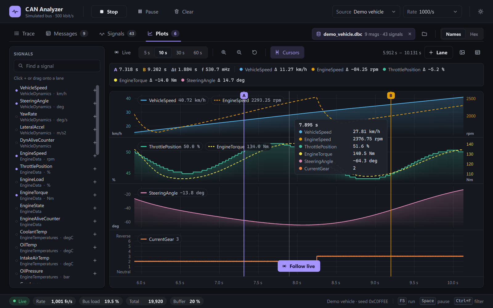
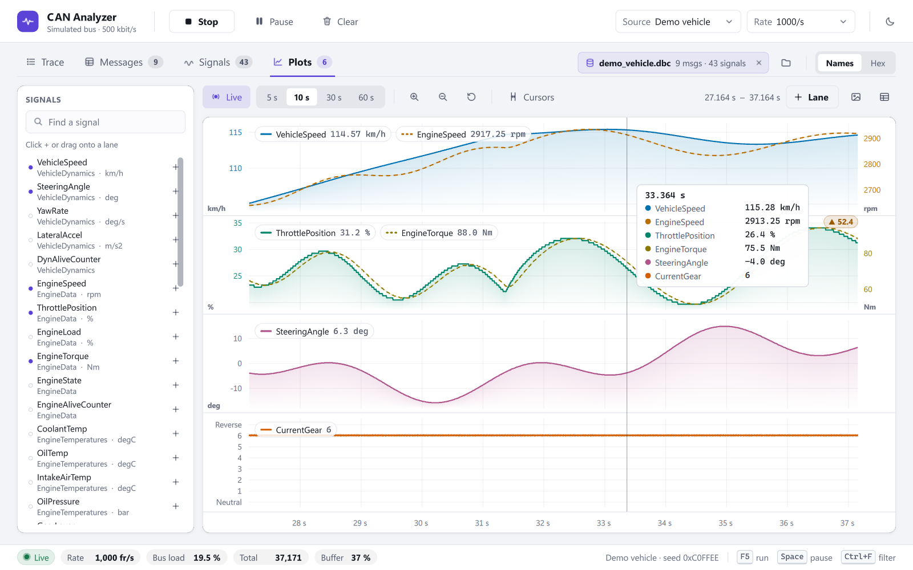
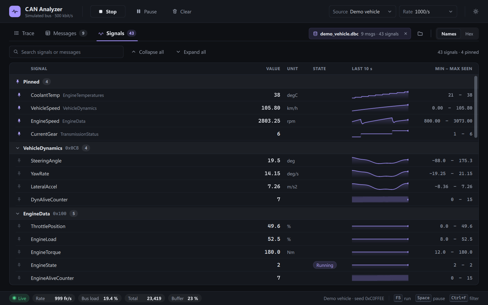
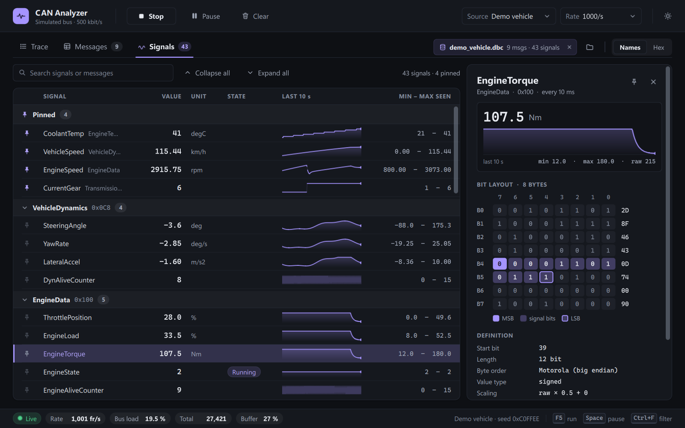
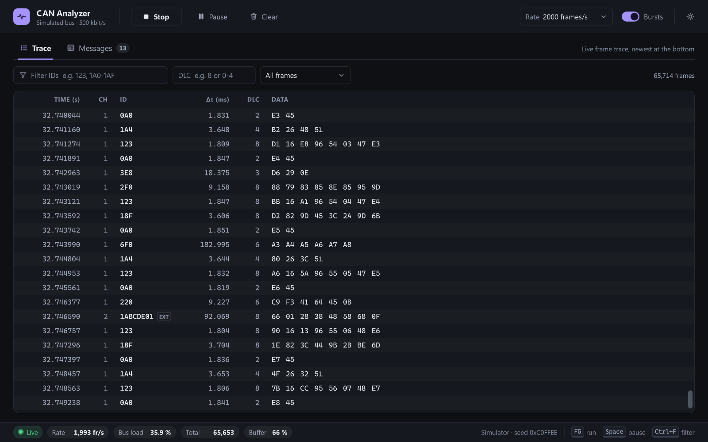
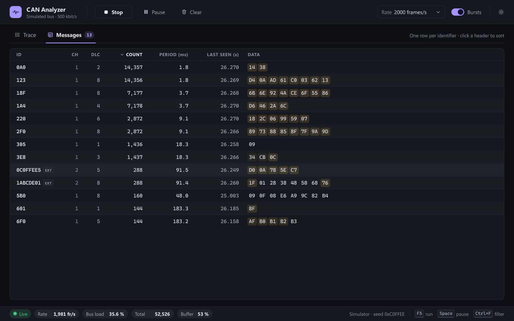
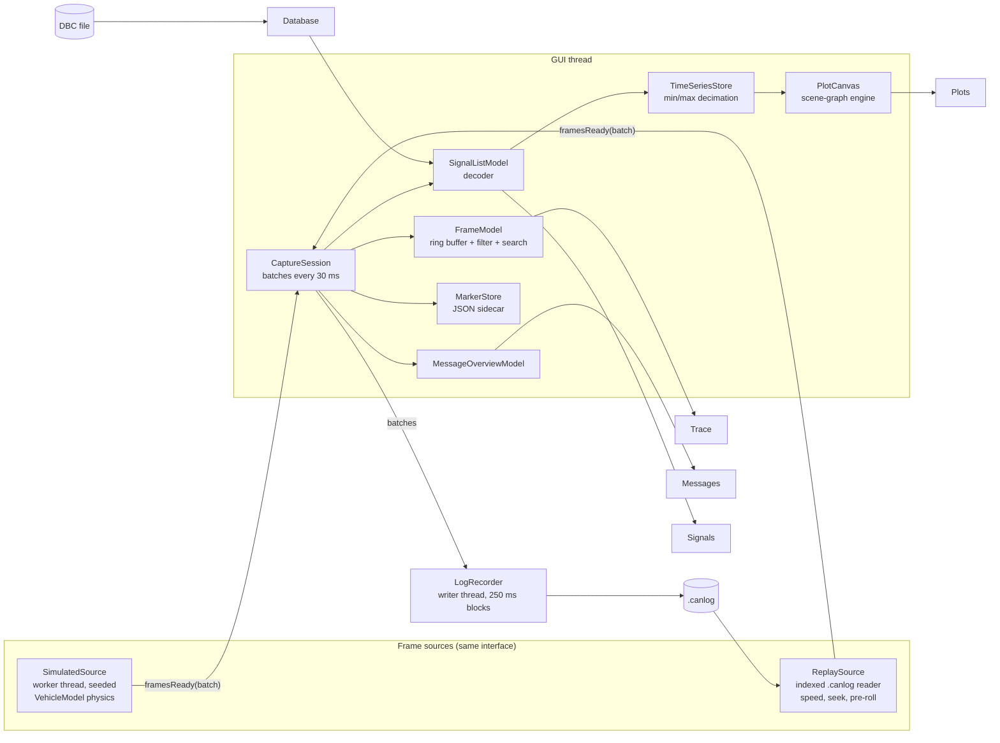

# CAN Analyzer

▶ **[Watch the 1-minute demo video on YouTube](https://youtu.be/ILNY42n71yI)**

**A Windows desktop tool for watching, decoding, recording and replaying CAN bus traffic.**
CAN Analyzer streams thousands of frames per second into a live trace, decodes them with a
DBC signal database, plots any signal over time in stacked, synchronised lanes, records
everything to a compact, crash-safe log format and replays logs through the same views
with markers, search and per-ID statistics. It is written in C++20 with a Qt 6 Quick/QML
front end and its own design system. There is no hardware in this project: the bus is a
built-in, deterministic vehicle simulator, so everything can be tried right away.

<!-- Screenshot placeholders for version 1.0. Copy the PNGs you like from
     evidence/screenshots/ (created by `can_analyzer --demo`) to docs/img/ and un-comment:


-->

| | |
|---|---|
|  |  |
| **Plots**: stacked lanes on one time axis, per-unit axes, cursors with Δt and value deltas | **Light theme**: crosshair tooltip, dashed second series, threshold, gear as a step plot |
|  |  |
| **Signals**: grouped by message, live values, sparklines, pinned signals | **Signal detail**: live chart, bit layout of the 8 data bytes, definition |
|  |  |
| **Trace**: every frame, decoded on demand, filters, pause without loss | **Messages**: one row per ID with rate, period and last data |

## Features

- **Live trace**: timestamp, channel, ID or message name, Δt per ID, DLC and data;
  100,000-frame ring buffer; filters by ID list/range, DLC and frame format; pause freezes
  the view while capture continues; a selected row expands into its decoded signals.
- **Messages overview**: one row per ID with count, rate, measured period and changed-byte
  highlighting; multiplexed messages expand per page.
- **DBC decoding**: own parser for the common DBC subset (Intel and Motorola byte order,
  signed values, factor/offset, value tables, simple multiplexing), with line-numbered
  error messages; the bundled `demo_vehicle.dbc` loads with one click.
- **Signal list**: every signal with its live value, unit, a 10 s sparkline and pinning;
  a detail panel with the bit layout of the message.
- **Multi-lane plots**: stacked lanes sharing one time axis, several signals per lane,
  left/right axes per unit, colour-blind-safe palette plus a dash pattern, step plots with
  state names for enumerations, follow live (5–60 s), zoom, pan, cursors A/B with Δt,
  frequency and value deltas, draggable thresholds, crosshair tooltip, min/max band so a
  spike is never lost, PNG and CSV export.
- **Logging**: Record writes everything the bus delivers to a `.canlog` file on a background
  thread, flushed every 250 ms, so an abrupt stop loses at most a quarter of a second.
  A REC chip shows the duration and file size.
- **Replay**: logs play through the same trace, messages, signals and plots: play/pause,
  0.25×–8× or as fast as possible, loop, seek bar with a time preview, jump to start/end,
  single-frame steps. Seeking is instant even in a 1,000,000-frame log.
- **Markers**: named markers at the current replay time, shown on the seek bar and as lines
  in the plots, with jumps between them; saved next to the log.
- **Search**: find frames in the trace by ID or message name, by data pattern with wildcard
  bytes (`12 ?? FF`) or by signal condition (`VehicleSpeed > 100`, `GearLever = D`);
  matches are highlighted, F3 / Shift+F3 jump between them.
- **Log summary**: duration, frame count, first/last timestamp, average and peak bus load,
  and per-ID count, share, rate, period (mean, min, max), DLC and load, exportable as CSV.
- **Export and import**: frames as CSV (documented columns), CSV files open like logs.
- **Comfort**: welcome screen with a one-click demo, dark and light themes, settings
  remembered between runs (theme, window, tab, database, plot layout, filters), drag and
  drop of logs and DBC files, keyboard shortcuts for everything frequent, About dialog with
  version, build and license information.

### Keyboard shortcuts

| Key | Action |
|---|---|
| F5 | Start / stop the simulator |
| Space | Pause the view (live) / play–pause (replay) |
| Ctrl+R | Start / stop recording |
| Ctrl+Shift+O | Open a log for replay |
| . | Replay: step one frame |
| M, [, ] | Replay: add a marker, previous / next marker |
| Ctrl+Home / Ctrl+End | Replay: jump to start / end |
| Ctrl+F, F3, Shift+F3 | Trace: find, next / previous match |
| Ctrl+1 … Ctrl+4 | Trace / Messages / Signals / Plots |
| F / + / − / 0 | Plots: follow live / zoom in / zoom out / reset view |
| C / Esc | Plots: place measurement cursors / clear them |
| Ctrl+O, Ctrl+N, Ctrl+T, Ctrl+L, F1 | Open DBC, names/hex, theme, clear, About |

## Architecture



- `src/core/`: the engine, with no Qt Quick dependency (Qt Core only). It holds frames,
  sources, the simulator, the DBC parser and the one signal codec used by the decoder, the
  simulator and the bit-layout view. It also holds the models, the time-series store, plot
  maths, the log format (`canlog.*`), the recorder, replay, markers, search and the log
  summary.
- `src/app/`: QML screens, the scene-graph plot engine `PlotCanvas`, the design system
  (`ui/`, module `CanUi`) and the custom Controls style (`style/`, module `CanStyle`).
- `tools/`: `can_logtool` (generate the sample log, inspect, convert, benchmark) and the
  build-time icon renderer.
- `tests/`: 17 Qt Test suites run by CTest. `bench/`: the optional Qt Charts comparison.
- `docs/`: decisions, the log format, explainers for each phase, a case study.

## Performance

Measured on the development machine (Windows 11, Direct3D 11, 1280 × 800 at 125 %).

**Plots**: 8 signals at 1000 Hz, 10 s window = 10,000 visible points per signal, 4 lanes:

| Engine | fps | p95 frame time |
|---|---|---|
| **PlotCanvas** (custom scene graph, min/max decimation, used by the app) | **60.0** (vsync) | 17.8 ms |
| PlotCanvas drawing all 80,000 raw points | 51.5 | 32.0 ms |
| Qt Charts, OpenGL | 36.2 | 36.2 ms |
| Qt Charts, raster | 2.7 | 439 ms |

Decimating 8 × 60,000 samples (10 minutes at 100 Hz) to 1200 pixel columns takes about 3 ms.

**Large logs**: 1,000,000 frames of demo traffic (`can_logtool bench`):

| | |
|---|---|
| File size | 12.6 MiB (13.2 bytes per frame) |
| Index | 2000 block headers, 94 KiB in memory |
| Open + index | 13 ms |
| Random seek (1000 seeks) | 27 µs average, 70 µs worst |
| Sequential read of all frames | 42 ms |
| CSV export | 0.27 s (39.7 MiB) |
| Process memory during all of the above | 11 MiB peak working set |

**Live**: 2000 frames/s from the simulator with 30 ms batched updates; the trace keeps
about 50 rendered frames per second while the demo capture grabs every frame.

Reproduce: `can_analyzer --plot-bench result.txt`, `can_charts_bench result.txt`,
`can_logtool bench --report result.txt`.

## Run the release zip

1. Unzip `CANSignalAnalyzer-1.0.0-win64.zip` anywhere (no installation, no admin rights;
   the Qt and Visual C++ runtimes are inside).
2. Start `can_analyzer.exe` and click **Start with the demo**.
3. Open `samples\demo_drive_60s.canlog` (Ctrl+Shift+O, or drag it onto the window) to try
   replay, markers, search and the summary.

Settings are stored per user under `HKEY_CURRENT_USER\Software\CanAnalyzer`, and recorded logs
default to `Documents\CAN Analyzer logs`.

## Build from source

Requirements: Qt 6.5+ (developed with Qt 6.12.0, MSVC 64-bit kit), CMake ≥ 3.25, Ninja and
a C++20 compiler (Visual Studio 2022 or newer). Machine paths are never committed:
`CMakePresets.json` reads the Qt kit from the `QT_ROOT` environment variable, and your own
paths go in the git-ignored `CMakeUserPresets.json`.

```bat
set QT_ROOT=C:\Qt\6.12.0\msvc2022_64
cmake --preset release
cmake --build --preset release
ctest --preset release
cmake --build --preset release --target package_zip   :: dist\CANSignalAnalyzer-<version>-win64.zip
```

Or, in one step (build, deploy the Qt runtime, start):
`powershell -ExecutionPolicy Bypass -File scripts\run.ps1`.

Details, the user preset and Qt Creator setup are in [docs/building.md](docs/building.md).

**Command line**:
- `can_analyzer [log]` opens a log in replay.
- `--rate <fps>` sets the simulator rate. `--seed <n>` makes the simulated traffic reproducible.
- `--demo` records the scripted showcase (application window only, 12 fps JPEG frames plus
  8 screenshots in `evidence/`). `--layout-check` captures edge cases.
- `--smoke-test <log>` is a quick self-test used for the release package.

The version is defined once, in the top-level `CMakeLists.txt`.

## Formats

- **`.canlog`**: a compact, versioned, block-based binary log with relative timestamps,
  CRC-protected blocks that double as the seek index, and crash-safe streaming writes.
  Specification: [docs/log-format.md](docs/log-format.md).
- **CSV frames**: `time_s,channel,id,format,dlc,data`, documented in the same file.
- **DBC**: the common subset (`BO_`, `SG_` incl. simple multiplexing, `VAL_`, `CM_`,
  `BA_ "GenMsgCycleTime"`). Not supported: CAN FD, extended multiplexing, float signals,
  named value tables, signal groups.

## License

- CAN Analyzer's own code is under the **MIT license** ([LICENSE](LICENSE)).
- **Qt** is used under the **GNU LGPL v3**, dynamically linked and unmodified. Modules:
  Qt Core, Gui, Qml, Quick, Quick Controls 2, Quick Dialogs, Quick Layouts, Quick Shapes,
  Quick Effects, Svg, and Qt Test for the tests only. The optional benchmark additionally
  uses Qt Charts and Qt Widgets.
- The release zip contains the license texts, the Qt source location and how to replace
  the Qt libraries with your own build (`THIRD_PARTY/`), plus the app-local Microsoft Visual
  C++ runtime.
- All data is invented: the demo database, the simulated vehicle and the sample log were
  made for this project. The app icon and the UI icons are original.

## Roadmap

1. **CAN FD**: 64-byte payloads, bit-rate switch, FD frames in the log format (a new flags
   bit; the format version allows it).
2. **Float signals** (`SIG_VALTYPE_`) and **more DBC features**: extended multiplexing,
   named value tables, signal groups, attribute definitions.
3. Import and export of common log formats (ASC, BLF reading).
4. Hardware adapters behind the same `FrameSource` interface.
5. X–Y plots, FFT and math channels; triggers with a pre-trigger buffer for recording.

## Documentation

[Case study](docs/case-study.md) · [Log format](docs/log-format.md) ·
[Decisions](docs/decisions.md) · [Building](docs/building.md) ·
Plain-English explainers: [phase 1](docs/phase1-explained.md),
[phase 2](docs/phase2-explained.md), [phase 3](docs/phase3-explained.md),
[phase 4](docs/phase4-explained.md)
