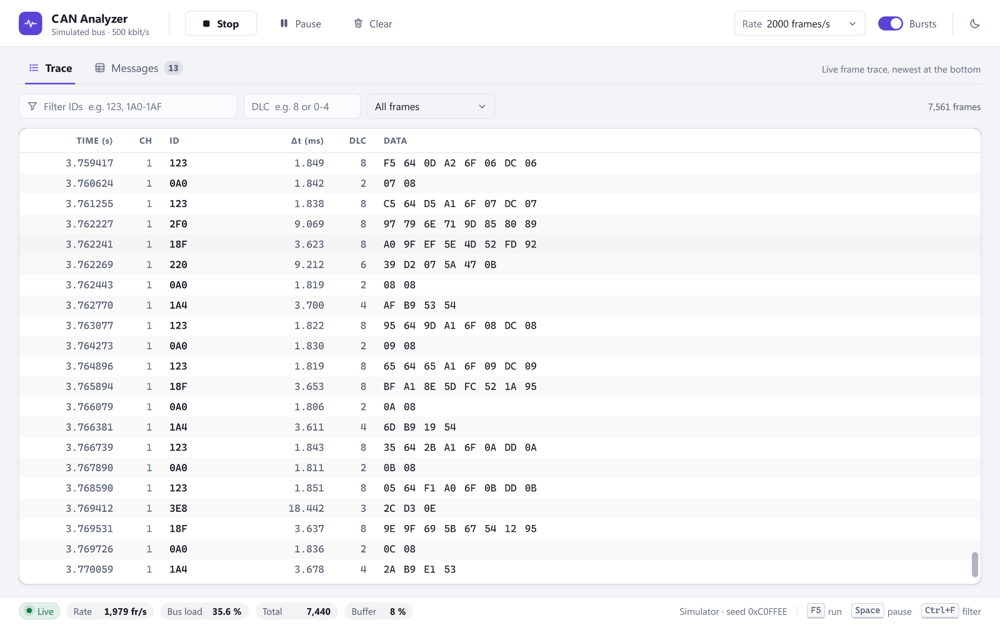
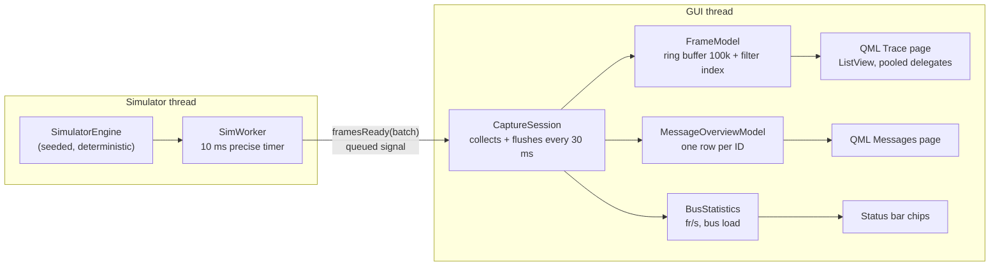

# CAN Analyzer

A Windows desktop app that shows CAN bus traffic live, like the trace view of a
professional bus tool. C++20 core, Qt 6 Quick/QML front end, custom design system.

Phase 1 has **no hardware**: frames come from a built-in, seeded simulator with invented
message IDs. Later phases add signal decoding, plots, logging and replay.

> Screenshots: `evidence/screenshots/` after running `--demo` (see below).
>
>  <!-- placeholder: copy 01-trace-live-light.png here -->
>  <!-- placeholder: copy 04-messages-dark.png here -->
>
> Demo video: _link to be added_

## Features

- **Live trace**: time, channel, ID, per-ID Δt, DLC and hex data; follows the live end and
  stops following as soon as you scroll up ("Jump to live" brings it back, or press End).
- **Messages overview**: one row per ID with count, measured period, last-seen time and the
  latest payload; changed bytes flash briefly; sortable by any column.
- **Filtering**: IDs (single, list or range, e.g. `123, 1A0-1AF`), data length (`8`, `0-4`)
  and frame format (standard/extended). Invalid input shows a friendly inline message and
  keeps the last valid filter.
- **Pause / resume** that freezes the view but keeps capturing; nothing is lost.
- **Statistics**: frames/s, estimated bus load at 500 kbit/s, total frames, buffer fill.
- **Simulator**: 12 invented messages (10–1000 ms periods), counters, slow sines, random
  walks, bit flags, variable DLC, optional bursts; adjustable total rate up to 2000 fr/s;
  fully deterministic for a given seed.
- **Performance**: 100,000-frame ring buffer, 30 ms batched model updates; about 50 rendered
  frames/s at 2000 bus frames/s while capturing demo PNGs.
- **Design**: dark and light themes with an animated switch, custom-styled controls,
  hand-drawn icons, WCAG AA contrast, keyboard shortcuts, empty states.

### Keyboard shortcuts

| Key | Action |
|---|---|
| F5 | Start / stop the simulator |
| Space or F6 | Pause / resume the view |
| Ctrl+L | Clear trace and statistics |
| Ctrl+F | Focus the ID filter |
| Esc | Leave a filter field / reset the filter |
| End | Jump to the live end of the trace |
| Ctrl+1 / Ctrl+2 | Trace / Messages tab |
| Ctrl+T | Toggle dark / light theme |

## Architecture



- `src/core/` — **no Qt Quick dependency** (Qt Core only): `CanFrame`, `RingBuffer`,
  `FrameSource` / `SimulatedSource` / `SimulatorEngine`, `FrameFilter`, `BusStatistics`,
  `FrameModel`, `MessageOverviewModel`, `CaptureSession`.
- `src/app/ui/` — module `CanUi`: the `Theme` token singleton, icons and components.
- `src/app/style/` — module `CanStyle`: the custom Qt Quick Controls style.
- `src/app/qml/` — module `CanAnalyzer`: the screens.
- `tests/` — Qt Test suites run by CTest.
- `docs/` — design system, decisions, progress log, plain-English explainer.

## Building

Requirements: Qt 6.5+ (developed with Qt 6.12.0, MSVC 2022 64-bit kit), CMake ≥ 3.25,
Ninja, and a C++20 compiler (MSVC from Visual Studio 2022 or newer, or the MinGW kit that
ships with Qt).

Machine-specific paths are never committed. `CMakePresets.json` reads the Qt kit from the
**`QT_ROOT`** environment variable; your own paths go in a git-ignored
`CMakeUserPresets.json`.

### Option A: environment variable

From a "x64 Native Tools Command Prompt" (MSVC) with CMake and Ninja on PATH:

```bat
set QT_ROOT=C:\Qt\6.12.0\msvc2022_64
cmake --preset release
cmake --build --preset release
ctest --preset release
```

### Option B: user preset (recommended)

Copy `CMakeUserPresets.json.example` to `CMakeUserPresets.json`, fill in your Qt kit and
Ninja paths, then:

```bat
cmake --preset local-release
cmake --build --preset local-release
ctest --preset local-release
```

### Running

The build tree does not contain the Qt DLLs. Either put `%QT_ROOT%\bin` on PATH for the
current shell, or deploy the runtime next to the executable once:

```bat
cmake --build --preset local-release --target deploy
build\local-release\can_analyzer.exe
```

Command-line options: `--rate <fps>` (initial rate, `0` = nominal ≈366/s), `--seed <n>`,
`--capacity <frames>` (ring buffer size), `--demo`, `--layout-check`, `--evidence-dir <dir>`.

## Demo mode

```bat
can_analyzer.exe --demo --rate 2000
powershell -ExecutionPolicy Bypass -File tools\zip-frames.ps1
```

`--demo` plays a scripted 45 s scene (start, Trace, typing an ID filter, pause and resume,
a slow-ID filter, scrolling away and jumping back, Messages and sorting, dark theme and
back) and saves:

- `evidence/frames/frame_NNNN.png` — about 5 frames per second (≈225 frames),
- `evidence/screenshots/01…05-*.png` — five named screenshots of the main screens,
- `evidence/demo-log.txt` — render rate and bus rate every 5 s.

Only the application window is captured (`QQuickWindow::grabWindow` renders the window's
own scene graph), never the desktop. `tools/zip-frames.ps1` packs the frames into
`evidence/frames.zip`. `--layout-check` captures edge cases (empty states, minimum window
size, filter errors, detached and paused views) into `evidence/checks/`.
`evidence/` is git-ignored.

## Roadmap

1. **Decoding**: a message/signal database (own format, then DBC import), physical values
   with units next to the raw bytes.
2. **Plots**: live signal charts with cursors and zoom.
3. **Logging**: record to an open log format with triggers and pre-trigger buffer.
4. **Replay**: a `FrameSource` that replays logs at 1×/n× speed; the rest of the app is
   already source-agnostic.
5. Hardware adapters behind the same `FrameSource` interface; CAN FD.

## Licensing

- Qt is used under the open-source **GNU LGPL v3**, **dynamically linked** (the Qt DLLs
  are separate files and can be replaced by the user). No Qt source code is modified.
- Qt modules used: **Qt Core, Qt Gui, Qt Qml, Qt Quick, Qt Quick Controls 2** (incl.
  Templates and the Basic fallback style), **Qt Quick Effects** (shadows, via the
  `QtQuick.Effects` QML module), **Qt Svg** (icon rendering), and **Qt Test** (tests only).
- Fonts are not shipped: the app uses Segoe UI Variable / Cascadia Mono already installed
  with Windows.
- No proprietary code, data, DBC files, captures or configurations are included. All CAN
  IDs, message names and payloads are invented and generated by the simulator. The icons
  are original.
